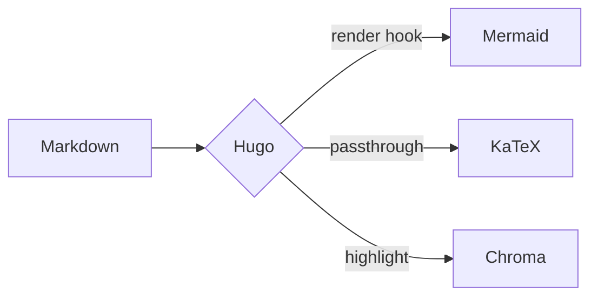
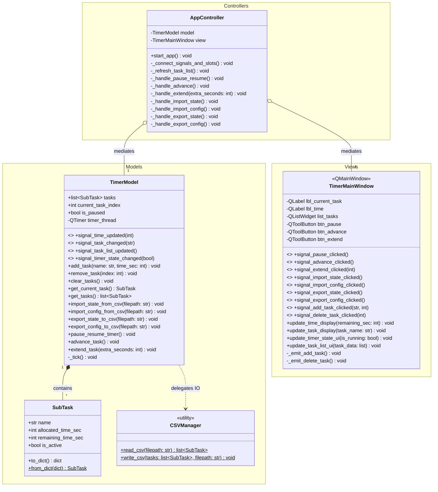

+++
title = 'Comprehensive Test'
date = 2026-07-30T11:00:00-07:00
draft = false
tags = ['red','green','blue']
+++

This post exercises everything the theme renders: text, links, lists, quotes, images, code, math, diagrams and tables. It has no `description` on purpose, so the link-preview text comes from this paragraph.

## Typography

Plain text with **bold**, *italic*, ***both***, ~~strikethrough~~, `inline code`, <kbd>Ctrl</kbd> + <kbd>C</kbd>, H<sub>2</sub>O and E = mc<sup>2</sup>. A footnote goes here.[^1]

### Third-level heading

#### Fourth-level heading

Occaecat aliqua consequat laborum ut ex aute aliqua culpa quis irure esse magna dolore quis. Proident fugiat labore eu laboris officia Lorem enim. Ipsum occaecat cillum ut tempor id sint aliqua incididunt nisi incididunt reprehenderit.

---

## CJK & Hangul

### 中文段落

广州天河科韵路大排档的格局，是和别处不同的：都是当街一口大铝锅，里面滚着老卤，随时能斩一份十五块钱的隆江猪脚饭。在天河软件园和网易外包打螺丝的码农，傍晚散了工，每每花十五块钱，加个卤蛋，靠在红塑料凳上划拉着手机吃完。倘肯多花四块，便能加一瓶冰镇维他柠檬茶
{lang="zh-Hans"}

### 日本語（漢字・ひらがな・カタカナ）

<ruby>自分<rt>じぶん</rt></ruby>には、<ruby>人間<rt>にんげん</rt></ruby>の<ruby>営<rt>いとな</rt></ruby>む<ruby>生活<rt>せいかつ</rt></ruby>なるものが<ruby>見当<rt>けんとう</rt></ruby>もつかない、という<ruby>恐怖<rt>きょうふ</rt></ruby>があり、<ruby>自分<rt>じぶん</rt></ruby>の<ruby>幸福<rt>こうふく</rt></ruby>の<ruby>観念<rt>かんねん</rt></ruby>と、<ruby>世<rt>よ</rt></ruby>のすべての人たちの<ruby>幸福<rt>こうふく</rt></ruby>の<ruby>観念<rt>かんねん</rt></ruby>とが、まるですれちがっているような、<ruby>不安<rt>ふあん</rt></ruby>の<ruby>念<rt>ねん</rt></ruby>に<ruby>夜々<rt>よよ</rt></ruby><ruby>悶々<rt>もんもん</rt></ruby>として、のたうちまわり、ついに<ruby>発狂<rt>はっきょう</rt></ruby>するのではないかとさえ<ruby>思<rt>おも</rt></ruby>い<ruby>詰<rt>つ</rt></ruby>めました。
{lang="ja"}

Hiragana only: いろはにほへと ちりぬるを わかよたれそ つねならむ
{lang="ja"}

Katakana only: スシローペロペロペロペロペロペロペロペロペロペロペロペロ
{lang="ja"}

### 한국어

다람쥐 헌 쳇바퀴에 타고파. 키스의 고유조건은 입술끼리 만나야 하고 특별한 기술은 필요치 않다.
{lang="ko"}

### Same characters, different languages

The characters below are identical code points; only the `lang` tag differs, so each line should draw some of them differently (骨 and 角 are the clearest).

简体中文：骨 角 直 化 写 海 次 令
{lang="zh-Hans"}

繁體中文：骨 角 直 化 寫 海 次 令
{lang="zh-Hant"}

日本語：骨 角 直 化 写 海 次 令
{lang="ja"}

No lang tag (uses the default order, Simplified Chinese first): 骨 角 直 化 写 海 次 令

### Mixed scripts in one line

Hugo（ヒューゴ）で作った블로그 uses **粗体 / 太字 / 굵게**, *斜体 / 斜体 / 기울임*, `行内代码 インライン 인라인`, and a [内部链接・内部リンク・내부 링크](/posts/).

Full-width punctuation next to Latin: 「Hello」、『World』。（括弧）【隅付き】〈山括弧〉《二重》“引号”‘单引号’…—

Long unbroken run (should wrap without overflowing): 广州天河科韵路大排档广州天河科韵路大排档広州天河科韵路大排档いいよこいよいいよこいよズンドコベロンチョズンドコベロンチョT24소셜페스티벌T24소셜페스티벌

### Monospace alignment

Each CJK character should be exactly two Latin columns wide, so the `|` columns line up:

```text
| ID   | 名前         | 상태     |
|------|--------------|----------|
| 0001 | ねこ         | 태양     |
| 0002 | カタカナ     | 김정은   |
| 0003 | 猪脚饭       | OK       |
| 0004 | abcdefghijkl | abcdefgh |
```

```python {title="多言語.py"}
greetings = {
    "zh": "你好，世界",       # 中文
    "ja": "さよなら、ララ",  # 日本語
    "ko": "오빤, 강남 스타일",  # 한국어
}
for lang, text in greetings.items():
    print(f"{lang}: {text}")
```

### Table with CJK

| 言語 | 文字 | 例 |
| :--- | :--- | :--- |
| 中文 | 汉字 | 隆江猪脚饭 |
| 日本語 | ひらがな・カタカナ・漢字 | チーズ牛丼 |
| 한국어 | 한글 | 떡볶이 |

## Slavic

### Кириллица

Я пришёл дать эту песню.

Русский: Съешь же ещё этих мягких французских булок, да выпей чаю.

Українська: Чуєш їх, доцю, га? Кумедна ж ти, прощайся без ґольфів!

Български: Ах, чудна българска земьо, полюшвай цъфтящи жита.

Српски: Љубазни фењерџија чађавог лица хоће да ми покаже штос.

### Latin with diacritics

Polski: Zażółć gęślą jaźń.

Čeština: Příliš žluťoučký kůň úpěl ďábelské ódy.

Hrvatski: Gojazni đačić s biciklom drži hmelj i finu vatu u džepu nošnje.

### Mixed and styled

**Жирный**, *курсив*, ~~зачёркнутый~~, `код на кириллице`, and a [внутренняя ссылка](/posts/) next to Latin and 中文.

«Ёлочные кавычки» — длинное тире, „немецкие“ and “English” quotes on one line.

Long word, tagged `{lang="ru"}` (should hyphenate at a syllable, e.g. превысокомного‐рассмотрительствующий):

Превысокомногорассмотрительствующий
{lang="ru"}

Same word untagged (no hyphen, but should still break instead of overflowing): превысокомногорассмотрительствующий

```python {title="привет.py"}
слова = ["Я", "пришёл", "дать", "эту", "песню"]
print(" ".join(слова))  # Я пришёл дать эту песню
```

---

## Links

- Internal: [all posts](/posts/) and [the about page](/about/)
- External: [Hugo documentation](https://gohugo.io/documentation/)
- Email: [someone@example.com](mailto:someone@example.com)
- Long wrapping internal link: [this internal link has enough words in it that it should wrap onto a second line on narrow screens](/tags/)

## Lists

1. Four legs good, two legs bad
2. All animals are equal
   - But some animals are more equal than others
   - No animal shall sleep in a bed with sheets
     1. (except the Pigs)
3. Last ordered item

- [x] Task done
- [ ] Task not done

## Blockquote

Soft line breaks inside one paragraph:

> Blockquotes can span multiple lines:
> **One**, nothing wrong with me!
> **Two**, nothing wrong with me!
> **Three**, nothing wrong with me!
> **Four**, nothing wrong with me!

Two paragraphs:

> Sit excepteur do velit veniam mollit in nostrud laboris incididunt ea.
>
> Amet eu cillum ut reprehenderit culpa aliquip labore laborum amet sit sit duis.

## Images

Captioned image:


Uncaptioned image:


Captioned inline base64 SVG:


## Code

Basic block:

```js
console.log('This site was generated by Hugo.');
```

Non-ASCII text (CJK should stay aligned in monospace):

```javascript
function helloZanarkand() {
  console.log("最後かもしれないだろ？だから 全部話しておきたいんだ...");
  return true;
}
```

With a file name:

```python {title="hello.py"}
def greet(name: str) -> str:
    return f"Hello, {name}!"

print(greet("Floral Cities"))
```

Long line (should scroll, not wrap):

```bash
hugo server -DF --noHTTPCache --disableFastRender --bind 0.0.0.0 --port 1313 --baseURL http://localhost:1313/ --logLevel debug
```

Inline line numbers (copy should skip the numbers):

```rust {linenos=inline}
fn main() {
    println!("line numbers inline");
}
```

Plain text:

```text
plain text block
    with indentation kept
```

## Math

Inline math: the equation \(a^*=x-b^*\) should compile instantly and flow with the text, as should \(e^{i\pi} + 1 = 0\).

Single dollars are a delimiter on this site, so $E = mc^2$ should stay render.

Block with `\[ \]`:

\[
\int_0^\infty e^{-x^2}\,dx = \frac{\sqrt{\pi}}{2}
\]

Chemistry with `\ce` and `\pu`, rendered without client-side JavaScript:

$$C_p[\ce{H2O(l)}] = \pu{75.3 J // mol K}$$

Wide equation (should scroll):

$$
f(x) = a_0 + a_1 x + a_2 x^2 + a_3 x^3 + a_4 x^4 + a_5 x^5 + a_6 x^6 + a_7 x^7 + a_8 x^8 + a_9 x^9 + a_{10} x^{10} + a_{11} x^{11} + a_{12} x^{12}
$$

## Diagrams

Small flowchart:



Wide class diagram (should shrink to fit; "open in new tab" shows it full size):



## Tables

| Feature | Syntax | Example |
|:--|:--|:--|
| Inline code | backticks | `npm run build` |
| Inline math | `\( \)` | \(x^2 + y^2 = r^2\) |
| Chemistry | `\ce{}` | \(\ce{CO2 + H2O}\) |
| Link | `[text](url)` | [posts](/posts/) |

Emoji in cells:

| Character      | Status      | Description                                      | Notes                      |
| :------------- | :---------- | :----------------------------------------------- | :------------------------- |
| Kaine          | ⚠️ Unstable | Struggling to control her possessed side.        | Monitor emotional state    |
| Popola         | ✅ Active   | Providing support and watching over the village. | Available for quests       |
| Grimoire Weiss | ❌ Offline  | Currently complaining about being called a book. | Requires immediate apology |

Wide table (should scroll):

| Column 1 | Column 2 | Column 3 | Column 4 | Column 5 | Column 6 | Column 7 | Column 8 | Column 9 | Column 10 |
|---|---|---|---|---|---|---|---|---|---|
| Lorem ipsum | dolor sit | amet consectetur | adipiscing elit | sed do | eiusmod tempor | incididunt ut | labore et | dolore magna | aliqua |

## Raw HTML

Langton's Ant, embedded as raw HTML with an inline script (needs `markup.goldmark.renderer.unsafe: true`). The controls use the theme's default form styles.

<div class="langton-ant">
    <p>
        <label for="size">Canvas size:</label>
        <select id="size">
            <option value="400" selected>400×400</option>
            <option value="600">600×600</option>
            <option value="800">800×800</option>
        </select>
        <label for="rule">Rule:</label>
        <input id="rule" type="text" value="RRLLLRLLLRRR" placeholder="R/L pattern" maxlength="32">
        <label for="cell">Cell size:</label>
        <input id="cell" type="number" value="3" min="1" max="20" style="width:70px">
        <label for="speed">Speed:</label>
        <input id="speed" type="range" min="1" max="1000" value="5" style="width:150px">
    </p>
    <p>
        <button onclick="thesims.init()">Start</button>
        <button onclick="thesims.paused = !thesims.paused">Pause</button>
        <button onclick="thesims.clear()">Clear</button>
        <span id="stats">Steps: 0</span>
    </p>
    <canvas id="canvas" style="max-width:100%; background:#fff; image-rendering:pixelated; display:block"></canvas>
</div>

<script>
    const thesims = {
        canvas: document.getElementById('canvas'),
        ctx: null,
        grid: null,
        ant: { x: 0, y: 0, dir: 0 },
        dirs: [[0,-1], [1,0], [0,1], [-1,0]],
        steps: 0,
        paused: false,

        init() {
            const size = parseInt(document.getElementById('size').value);
            this.canvas.width = this.canvas.height = size;
            this.ctx = this.canvas.getContext('2d');

            const rule = document.getElementById('rule').value.toUpperCase().replace(/[^RL]/g, '') || 'RL';
            this.cellSize = parseInt(document.getElementById('cell').value);
            this.rules = rule.split('');
            this.colors = this.goldenHues(this.rules.length);

            this.cols = Math.ceil(size / this.cellSize);
            this.rows = Math.ceil(size / this.cellSize);
            this.grid = new Uint8Array(this.cols * this.rows).fill(0);

            this.ant = { x: Math.floor(this.cols/2), y: Math.floor(this.rows/2), dir: 0 };
            this.ctx.fillStyle = this.colors[0];
            this.ctx.fillRect(0, 0, size, size);
            this.steps = 0;
            this.paused = false;
            if (!this.running) { this.running = true; this.loop(); }
        },

        goldenHues(n) {
            const c = ['#fff'], phi = 0.618033988749895;
            let h = Math.random();
            for (let i = 1; i < n; i++) {
                h = (h + phi) % 1;
                c.push(`hsl(${h*360}, 85%, 55%)`);
            }
            return c;
        },

        step() {
            const {x, y, dir} = this.ant;
            const i = y * this.cols + x;
            const s = this.grid[i];

            this.ant.dir = (dir + (this.rules[s] === 'R' ? 1 : 3)) % 4;
            const ns = (s + 1) % this.rules.length;
            this.grid[i] = ns;

            this.ctx.fillStyle = this.colors[ns];
            this.ctx.fillRect(x * this.cellSize, y * this.cellSize, this.cellSize, this.cellSize);

            const [dx, dy] = this.dirs[this.ant.dir];
            this.ant.x = (x + dx + this.cols) % this.cols;
            this.ant.y = (y + dy + this.rows) % this.rows;
            this.steps++;
        },

        loop() {
            if (!this.paused) {
                const speed = parseInt(document.getElementById('speed').value);
                for (let i = 0; i < speed; i++) this.step();
                document.getElementById('stats').textContent = `Steps: ${this.steps.toLocaleString()}`;
            }
            requestAnimationFrame(() => this.loop());
        },

        clear() {
            this.paused = true;
            this.ctx.fillStyle = '#fff';
            this.ctx.fillRect(0, 0, this.canvas.width, this.canvas.height);
            this.steps = 0;
            document.getElementById('stats').textContent = 'Steps: 0';
        }
    };

    thesims.init();
</script>

[^1]: Footnote text, linked back to where it was referenced.
